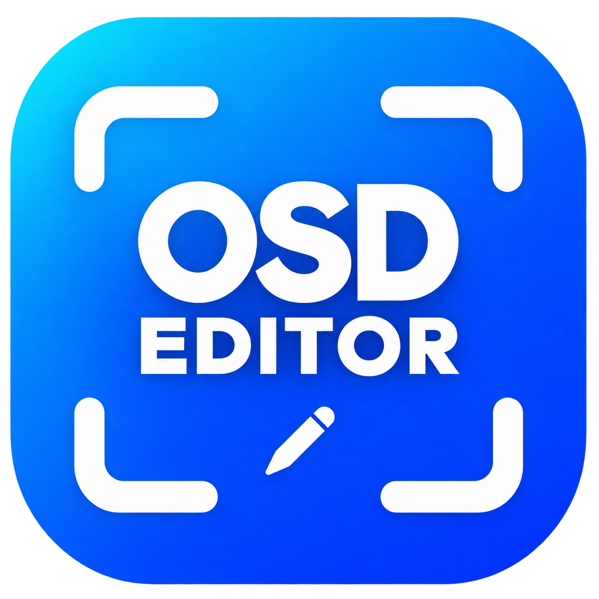

# OSD Editor

**Edit FPV OSD, telemetry and recordings on your Mac.**

Created by **Kris Gleave (KrisTalksTech)** for the FPV community.

[Download v1.0](https://github.com/krisgleave/osd-editor/releases/latest) · [User guide](docs/USER_GUIDE.md) · [Font setup](docs/FONTS.md) · [Report an issue](https://github.com/krisgleave/osd-editor/issues)

OSD Editor reconstructs supported recorded OSD so you can move, resize, colour and hide groups before exporting a new video. It can also add a written telemetry line, optional visual indicators and a custom OSD-font label such as a drone name.

**Tested with BETAFPV P1 / Artlynk recordings.** Support for other recording systems is not yet verified; community samples and testing are welcome.

## Requirements

| | v1.0 download |
|---|---|
| Computer | Apple Silicon Mac (M-series) |
| macOS | 27.0 or later |
| Media verified | Supplied BETAFPV P1 / Artlynk MP4 and matching SRT recordings |
| OSD font | User-imported compatible Walksnail PNG font |
| Extra software to run the app | None: no Homebrew, FFmpeg or Xcode required |

Development testing used an **M4 Pro MacBook Pro** with P1 sample recordings. This does not establish compatibility with every firmware, video mode or Mac. Intel, Windows, browser and older macOS builds are not included. See [compatibility and testing](docs/COMPATIBILITY.md).

## Get started

1. Download **OSD-Editor-1.0-Mac.zip** from [Releases](https://github.com/krisgleave/osd-editor/releases/latest). GitHub’s **Code → Download ZIP** contains source, not the app.
2. Unzip and move **OSD Editor.app** into Applications if desired.
3. Import a compatible OSD PNG when prompted. **Get OSD fonts…** opens Sneaky FPV’s site without closing the import dialogue. [Font instructions](docs/FONTS.md).
4. Open a recording. A same-name SRT in the same folder loads automatically; **Choose SRT** allows manual selection.
5. Select and arrange overlays, set the range and export format, then export a new MP4.

The app is locally/ad-hoc signed, **not Apple Developer ID signed or notarized**. See [installation and troubleshooting](docs/INSTALLATION.md) if macOS blocks it. Do not disable macOS security protections globally.

## Features

- Direct OSD group dragging and rectangle selection of whole groups.
- Individual or multi-item sizing, tint, hide/show and frame/selection alignment.
- Written telemetry line with selectable fields, font, colour, size and positioning.
- Optional SBat/GBat battery cards, signal bars, bitrate/history graph and distance indicator.
- Custom text using the imported OSD PNG font, with saved styling and position.
- **None / OSD / TELEM / VIS** selection targets; visual group dragging preserves spacing.
- Snap grid (32/48/64/96) and preview-only yellow centre guides.
- Playback, scrubbing, space-bar play/pause and In/Out trimming.
- 16:9/4:3 framing, overlay-fit checks and Original/2K/4K output.
- H.264 or HEVC exports retaining source frame timing; no frame-rate conversion setting.
- Sequential batch export, progress, cancellation and batch reports.
- Presets with save/rename/delete/import/export, aspect filtering and launch defaults.
- Managed font library; imported files are copied rather than referenced in Downloads.
- Light, dark and system appearance; native Mac window controls.

See the [full user guide](docs/USER_GUIDE.md) for behaviour and limitations.

## What it does not do

- It does not download recordings from the receiver, provide live FPV video or change firmware. [P1 Transfer](https://github.com/krisgleave/p1-transfer) is a separate project.
- It cannot independently remove or move OSD already burned into video pixels.
- It does not yet claim DJI, HDZero, analogue or general Walksnail editable-OSD support.
- OSD groups are recorded characters/positions, not semantically identified GPS/battery objects. Presets may need adjustment for another drone’s layout.
- Upscaling uses Lanczos resampling; it is not AI detail recovery.
- Battery fill is not measured remaining charge. Colour bands are configurable raw-voltage thresholds. See [telemetry limitations](docs/USER_GUIDE.md#telemetry-visuals).

## Help test more systems

Useful reports include recording system, receiver/goggles and firmware, video mode, Mac model/macOS, reproduction steps and expected results. Untouched MP4/SRT/OSD samples can help, but **do not post private footage or GPS/location data publicly**. Use the [compatibility report template](https://github.com/krisgleave/osd-editor/issues/new/choose) to describe your setup first.

## Support

The best way to support this project is to visit **[KrisTalksTech on YouTube](https://www.youtube.com/@KrisTalksTech)** and subscribe for FPV drone content and reviews.

If you would like to contribute financially, you can [support Kris through PayPal](https://www.paypal.me/krisgleave). Support is optional; the app is free and open source. Testing, helpful issue reports and contributions are welcome too.

## Credits and licence

- **Creator and maintainer:** Kris Gleave (**KrisTalksTech**).
- **Development assistance:** OpenAI Codex; icon concept generated with AI and selected by the maintainer.
- **OSD format/parser provenance:** [Alexander van Saase’s Walksnail OSD Tool](https://github.com/avsaase/walksnail-osd-tool) and [ksielick’s Artlynk-capable fork](https://github.com/ksielick/walksnail-osd-tool), with their contributors.
- **Optional user-supplied fonts:** [SNEAKY_FPV](https://sites.google.com/view/sneaky-fpv/home), Shannon M Baker. Fonts are separately licensed and **not bundled**.

OSD Editor is a separate native Swift/AppKit application incorporating adapted OSD parsing work. Different interface and features do not remove the upstream licence obligations. Source and original project assets are provided under **GPL-3.0-or-later**; see [LICENSE](LICENSE) and [THIRD_PARTY_NOTICES.md](THIRD_PARTY_NOTICES.md). Matching source/build scripts accompany each binary release.

This is an independent community project, not an official or endorsed product of BETAFPV, Walksnail/Caddx, DJI, HDZero, SNEAKY_FPV or Apple. Their names identify compatibility or provenance.
